# VoltDeck — visninger og sensoroppsett

[Home](../README.md) | [English](Display-gallery.md) | [Oppsett](Konfigurasjon-norsk.md)

Ekte **800 × 480 skjermopptak fra X20RS-simulatoren, ETHOS 26.1.2**, med stabil VoltDeck 2026.10-v9. Instrumentene og modellbildene tegnes av appen i simulatoren. Telemetrien er kontrollerte illustrasjonsdata; det var ingen fysisk mottaker eller sensor tilkoblet. Valgene under hvert bilde forteller hvordan visningen settes opp.

## Deck og Digital, med og uten bilde

<table>
<tr>
<td><a href="images/native-voltdeck-deck-photo.png">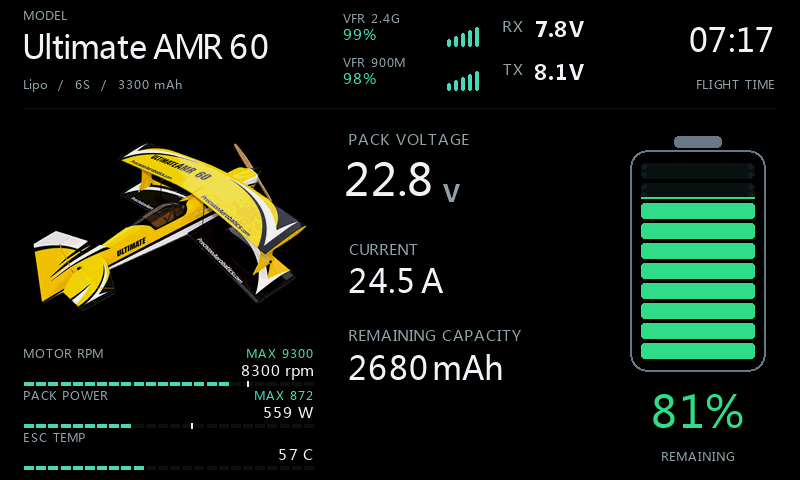</a> <b>Deck / modellbilde</b></td>
<td> <b>Deck / Hidden</b></td>
</tr>
<tr>
<td><a href="images/native-voltdeck-digital-photo.png">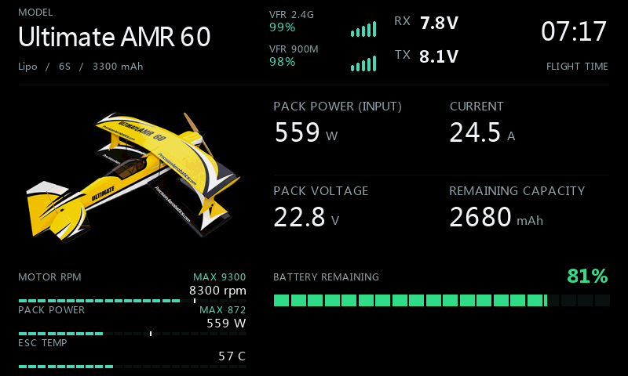</a> <b>Digital / modellbilde</b></td>
<td><a href="images/native-voltdeck-digital-hidden.png">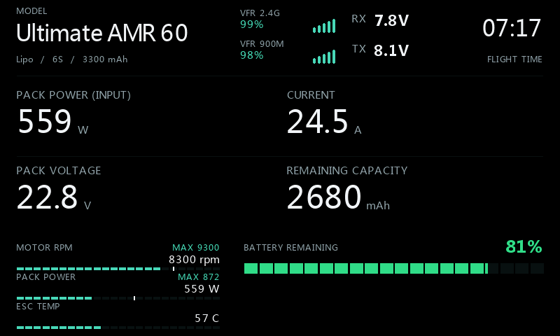</a> <b>Digital / Hidden</b></td>
</tr>
</table>

Velg **Appearance > Display style = Deck / Digital** og deretter **Image source = Image file / Selected model / Hidden**. Bildene her bruker Image file. Selected model gir samme bildeflate med bildet som er valgt i ETHOS-modellen. Bare eksplisitt Hidden omfordeler plassen; en bildefeil gjør ikke det. Deck er standard. Bilde- og stilvalg endrer ingen kilde eller beregningsmetode.

## Valgene i programmet

Åpne widgetmenyen og velg **Configure widget > Appearance**. **Display style** og **Image source** er separate valg. Kildevelgerne må settes til telemetrien som faktisk er oppdaget på egen radio; illustrasjonsdataene tilordner ingen sensorer automatisk.

<table>
<tr>
<td> <b>Display style</b></td>
<td> <b>Image source</b></td>
</tr>
</table>

Hovedbildene bruker **Lower deck > Show = RPM + W + cell**, **Meter style = Retro LCD**, **Custom source = ESC-temperatur**, **Custom label = ESC TEMP**, **Custom position = 3**, **Custom min/max = 0/150**, **Decimals (-1 auto) = 0**, **Remaining from = Consumed mAh**, **mAh display = Remaining** og **RPM value = Measured RPM**. **RPM scale = Manual**, **RPM max = 12000** og **Watt max = 1500**. Kjemi og kapasitet er oppgitt nedenfor. Med modellbilde/Digital bruker Custom én av de tre plassene; Deck + Hidden viser også cellefeltet.

## Modell, verdier og telemetri

Flyet er en **Ultimate AMR 60, elektrisk dobbeltdekker**. Eksempelbatteriet er **6S Lipo, 3300 mAh**. De fire hovedvisningene bruker 22,8 V, 24,5 A, 620 mAh forbrukt, 2680 mAh igjen og 81 %. Målt mekanisk turtall er 8300 rpm og ESC-temperaturen er 57 °C. Dette er et illustrert sensoroppsett, ikke målte data fra dette flyet.

| Rolle i programmet | Telemetri i eksemplet | Aktuelt oppsett |
| --- | --- | --- |
| Pack voltage | Batterispenning — V | Kompatibel ESC-telemetri, UniSens-E eller spennings-/strømsensor |
| Pack current | Motorstrøm — A | Kompatibel ESC, UniSens-E eller FAS-strømsensor |
| Consumed mAh | Akkumulert batteriforbruk — mAh | ESC/UniSens-E eller ETHOS Consumption beregnet fra strøm |
| RPM | Korrigert mekanisk motor-/propellturtall — rpm | ESC eller kompatibel RPM-sensor; poltall/utveksling korrigeres i telemetrikjeden |
| Custom | ESC-temperatur — °C | ESC-ens temperaturkanal; dette er ikke motor- eller sylindertemperatur |
| RX / TX | Mottaker-/senderspenning — V | Mottaker og radio |
| RF1 / RF2 | VFR 2.4G / VFR 900M — % | To faktisk oppdagede RF-kilder |
| Flight time | ETHOS-timer — s | Valgt modelltimer |

**559 W** er elektrisk inngangseffekt, 22,8 × 24,5. Det er ikke akseleffekt. **3,80 V** er gjennomsnittlig cellevolt, 22,8 / 6; det er ikke laveste enkeltcelle.

Prosentmetoden trenger en ekte kilde for gjenværende ladning i **%**. Spenningsestimat trenger batteriets **V**, batteritype og celletall. Det separate feltet for gjenværende mAh trenger fortsatt pålitelig forbrukt **mAh** og kapasitet med begge disse metodene. Metodeeksemplene viser bevisst ulike prosenter; dette er ingen nøyaktighetssammenligning.

Aktuelle oppsett er [FrSky FAS100 ADV](https://frskyna.com/products/frsky-adv-fas100-current-sensor) for spenning/strøm og [SM UniSens-E](https://www.sm-modellbau.de/UniSens-E) for elektrisk motortelemetri. En V/A-sensor gir ikke automatisk en mAh-teller: bruk en faktisk teller eller [ETHOS Consumption](https://ethos-doc.frsky-rc.com/model-setup/telemetry/#consumption-sensor). Kontroller den aktuelle FrSky-utgangen og enhetene for sensoren og fastvaren. Kildenavnene er eksempler, ikke en automatisk sensortilordning.

## Lower deck

Alle åtte valg er vist med **Numeric** og **Retro LCD**. Lower deck beholdes i Digital også. **Deck + Hidden** kan vise RPM, W, gjennomsnittlig cellevolt og Custom samtidig; bilde-Deck og Digital beholder tre plasser når Custom legges til. Custom position velger rekkefølgen.

| Lower deck | Nødvendige målinger |
| --- | --- |
| Only Custom | Custom numeric source + correct unit |
| RPM | Measured mechanical rpm, or explicitly selected KV estimate |
| Watts | Pack V + propulsion A |
| Cell volts | Pack V + series-cell count (average) |
| Voltage estimate | Pack V + chemistry + series-cell count |
| RPM + Watts | RPM + pack V + propulsion A |
| RPM + W + cell | RPM + pack V + propulsion A + cell count |
| Hidden | No lower instruments; consumers used by battery/log/alerts still apply |

### Numeric

Only Custom / Numeric

Valg: **Display style = Deck**; **Image source = Hidden**; **Lower deck > Show = Only Custom**; **Meter style = Numeric**; **Remaining from = Consumed mAh**; **mAh display = Remaining**; **RPM value = Measured RPM**; **Custom = ESC temperature (°C)**; **Custom position = 3**.

RPM / Numeric

Valg: **Display style = Deck**; **Image source = Hidden**; **Lower deck > Show = RPM**; **Meter style = Numeric**; **Remaining from = Consumed mAh**; **mAh display = Remaining**; **RPM value = Measured RPM**.

Watts / Numeric

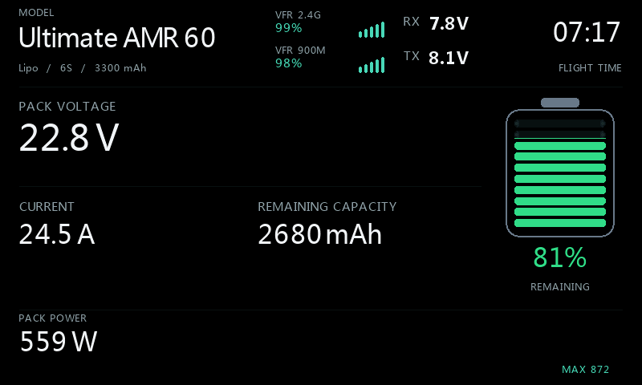

Valg: **Display style = Deck**; **Image source = Hidden**; **Lower deck > Show = Watts**; **Meter style = Numeric**; **Remaining from = Consumed mAh**; **mAh display = Remaining**; **RPM value = Measured RPM**.

Cell volts / Numeric

Valg: **Display style = Deck**; **Image source = Hidden**; **Lower deck > Show = Cell volts**; **Meter style = Numeric**; **Remaining from = Consumed mAh**; **mAh display = Remaining**; **RPM value = Measured RPM**.

Voltage estimate / Numeric

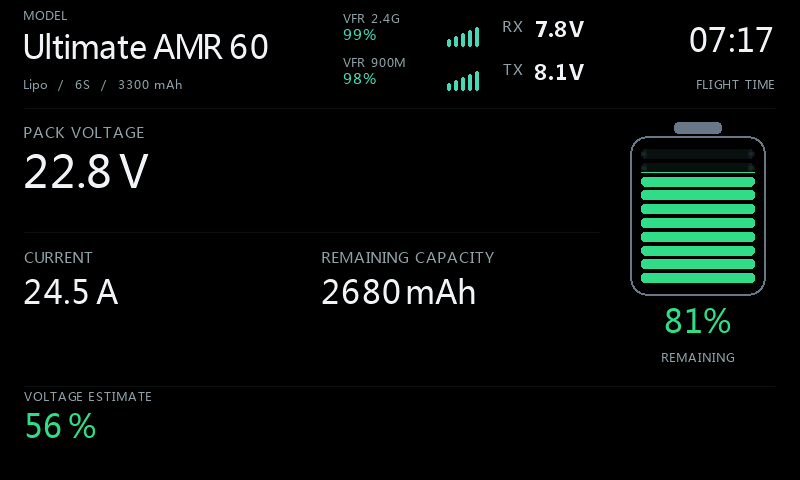

Valg: **Display style = Deck**; **Image source = Hidden**; **Lower deck > Show = Voltage estimate**; **Meter style = Numeric**; **Remaining from = Consumed mAh**; **mAh display = Remaining**; **RPM value = Measured RPM**.

RPM + Watts / Numeric

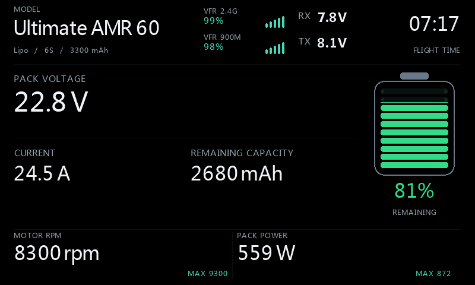

Valg: **Display style = Deck**; **Image source = Hidden**; **Lower deck > Show = RPM + Watts**; **Meter style = Numeric**; **Remaining from = Consumed mAh**; **mAh display = Remaining**; **RPM value = Measured RPM**.

RPM + W + cell / Numeric

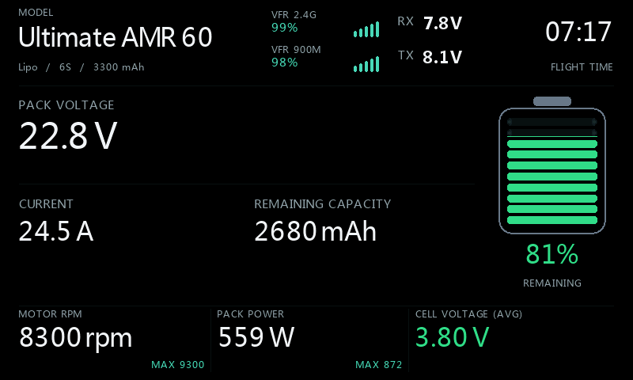

Valg: **Display style = Deck**; **Image source = Hidden**; **Lower deck > Show = RPM + W + cell**; **Meter style = Numeric**; **Remaining from = Consumed mAh**; **mAh display = Remaining**; **RPM value = Measured RPM**.

Hidden / Numeric

Valg: **Display style = Deck**; **Image source = Hidden**; **Lower deck > Show = Hidden**; **Meter style = Numeric**; **Remaining from = Consumed mAh**; **mAh display = Remaining**; **RPM value = Measured RPM**.

### Retro LCD

Only Custom / Retro LCD

Valg: **Display style = Deck**; **Image source = Hidden**; **Lower deck > Show = Only Custom**; **Meter style = Retro LCD**; **Remaining from = Consumed mAh**; **mAh display = Remaining**; **RPM value = Measured RPM**; **Custom = ESC temperature (°C)**; **Custom position = 3**.

RPM / Retro LCD

Valg: **Display style = Deck**; **Image source = Hidden**; **Lower deck > Show = RPM**; **Meter style = Retro LCD**; **Remaining from = Consumed mAh**; **mAh display = Remaining**; **RPM value = Measured RPM**.

Watts / Retro LCD

Valg: **Display style = Deck**; **Image source = Hidden**; **Lower deck > Show = Watts**; **Meter style = Retro LCD**; **Remaining from = Consumed mAh**; **mAh display = Remaining**; **RPM value = Measured RPM**.

Cell volts / Retro LCD

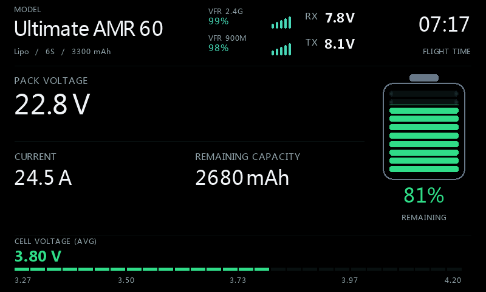

Valg: **Display style = Deck**; **Image source = Hidden**; **Lower deck > Show = Cell volts**; **Meter style = Retro LCD**; **Remaining from = Consumed mAh**; **mAh display = Remaining**; **RPM value = Measured RPM**.

Voltage estimate / Retro LCD

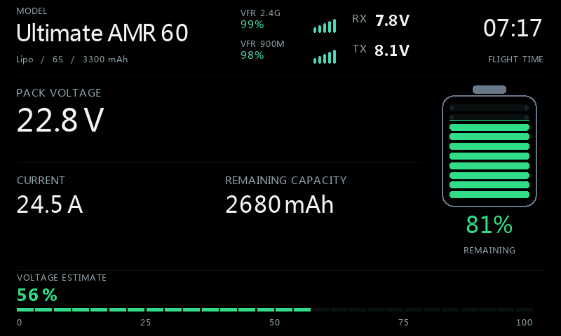

Valg: **Display style = Deck**; **Image source = Hidden**; **Lower deck > Show = Voltage estimate**; **Meter style = Retro LCD**; **Remaining from = Consumed mAh**; **mAh display = Remaining**; **RPM value = Measured RPM**.

RPM + Watts / Retro LCD

Valg: **Display style = Deck**; **Image source = Hidden**; **Lower deck > Show = RPM + Watts**; **Meter style = Retro LCD**; **Remaining from = Consumed mAh**; **mAh display = Remaining**; **RPM value = Measured RPM**.

RPM + W + cell / Retro LCD

Valg: **Display style = Deck**; **Image source = Hidden**; **Lower deck > Show = RPM + W + cell**; **Meter style = Retro LCD**; **Remaining from = Consumed mAh**; **mAh display = Remaining**; **RPM value = Measured RPM**.

Hidden / Retro LCD

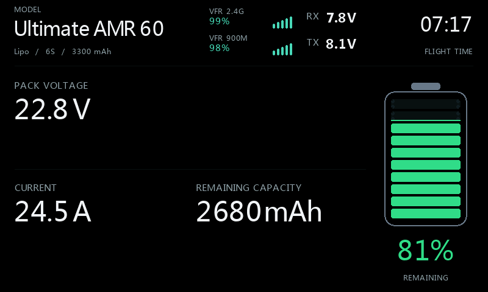

Valg: **Display style = Deck**; **Image source = Hidden**; **Lower deck > Show = Hidden**; **Meter style = Retro LCD**; **Remaining from = Consumed mAh**; **mAh display = Remaining**; **RPM value = Measured RPM**.

## Custom-plassering

RPM + Watts + Custom / position 1

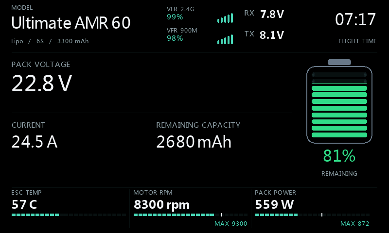

Valg: **Display style = Deck**; **Image source = Hidden**; **Lower deck > Show = RPM + Watts**; **Meter style = Retro LCD**; **Remaining from = Consumed mAh**; **mAh display = Remaining**; **RPM value = Measured RPM**; **Custom = ESC temperature (°C)**; **Custom position = 1**.

RPM + Watts + Custom / position 2

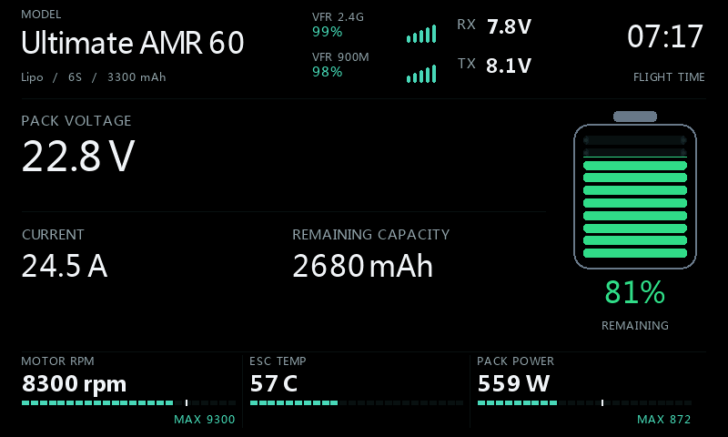

Valg: **Display style = Deck**; **Image source = Hidden**; **Lower deck > Show = RPM + Watts**; **Meter style = Retro LCD**; **Remaining from = Consumed mAh**; **mAh display = Remaining**; **RPM value = Measured RPM**; **Custom = ESC temperature (°C)**; **Custom position = 2**.

RPM + Watts + Custom / position 3

Valg: **Display style = Deck**; **Image source = Hidden**; **Lower deck > Show = RPM + Watts**; **Meter style = Retro LCD**; **Remaining from = Consumed mAh**; **mAh display = Remaining**; **RPM value = Measured RPM**; **Custom = ESC temperature (°C)**; **Custom position = 3**.

## Batterimetoder

Consumed mAh

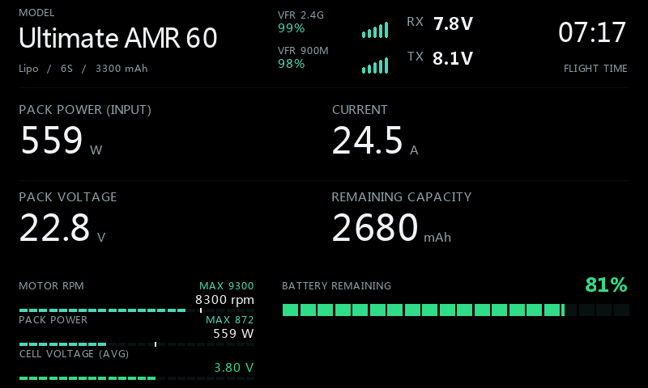

Valg: **Display style = Digital**; **Image source = Hidden**; **Lower deck > Show = RPM + W + cell**; **Meter style = Retro LCD**; **Remaining from = Consumed mAh**; **mAh display = Remaining**; **RPM value = Measured RPM**.

Percent sensor

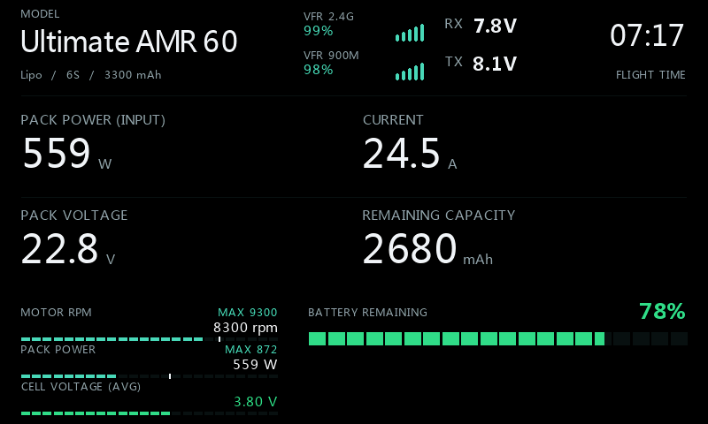

Valg: **Display style = Digital**; **Image source = Hidden**; **Lower deck > Show = RPM + W + cell**; **Meter style = Retro LCD**; **Remaining from = % sensor**; **mAh display = Remaining**; **RPM value = Measured RPM**.

Voltage estimate

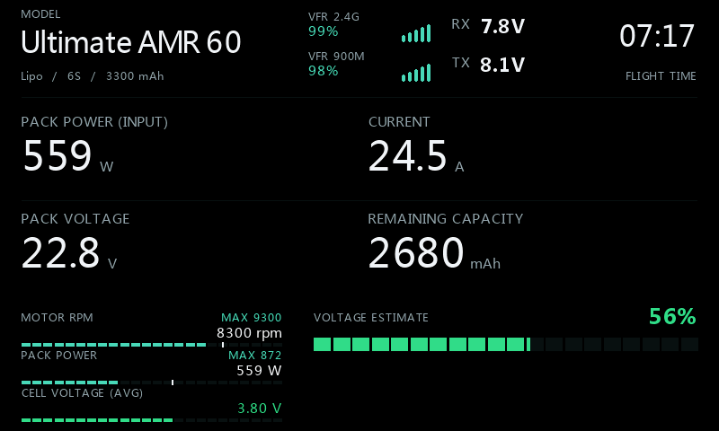

Valg: **Display style = Digital**; **Image source = Hidden**; **Lower deck > Show = RPM + W + cell**; **Meter style = Retro LCD**; **Remaining from = Voltage estimate**; **mAh display = Remaining**; **RPM value = Measured RPM**.

## mAh

Remaining mAh

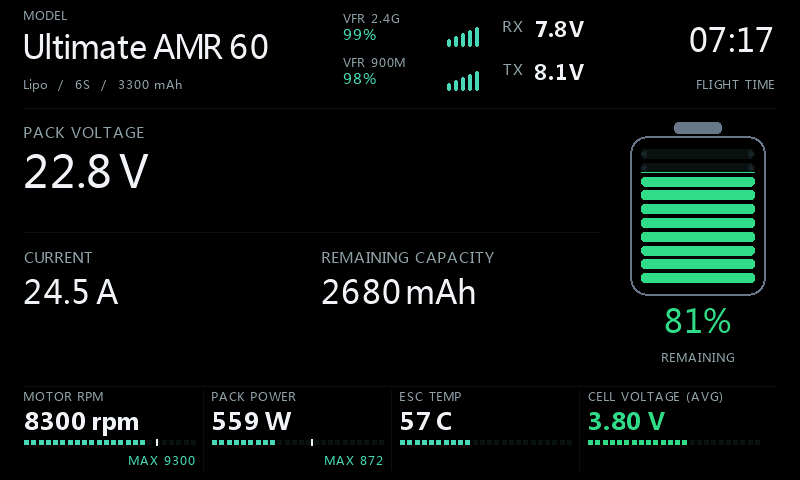

Valg: **Display style = Deck**; **Image source = Hidden**; **Lower deck > Show = RPM + W + cell**; **Meter style = Retro LCD**; **Remaining from = Consumed mAh**; **mAh display = Remaining**; **RPM value = Measured RPM**; **Custom = ESC temperature (°C)**; **Custom position = 3**.

Consumed mAh

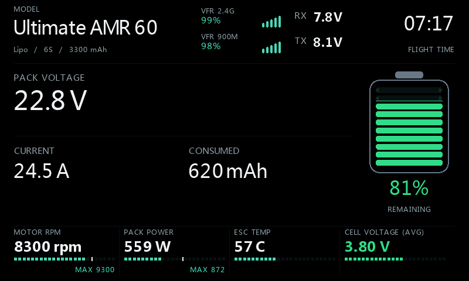

Valg: **Display style = Deck**; **Image source = Hidden**; **Lower deck > Show = RPM + W + cell**; **Meter style = Retro LCD**; **Remaining from = Consumed mAh**; **mAh display = Consumed**; **RPM value = Measured RPM**; **Custom = ESC temperature (°C)**; **Custom position = 3**.

## RPM

KV estimate, not measured RPM

Valg: **Display style = Deck**; **Image source = Hidden**; **Lower deck > Show = RPM**; **Meter style = Retro LCD**; **Remaining from = Consumed mAh**; **mAh display = Remaining**; **RPM value = KV x volts (est.)**; **Motor KV = 500**; **Estimate factor = 90%**.

Measured mechanical RPM

Valg: **Display style = Deck**; **Image source = Hidden**; **Lower deck > Show = RPM**; **Meter style = Retro LCD**; **Remaining from = Consumed mAh**; **mAh display = Remaining**; **RPM value = Measured RPM**.

## Tema og farger

Radio theme

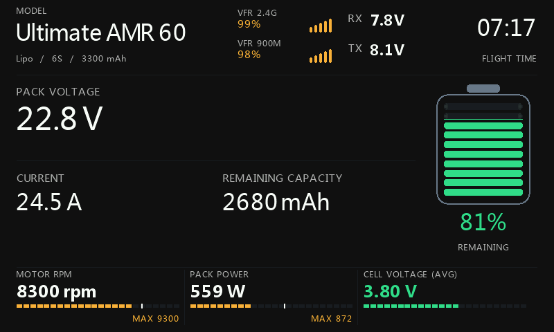

Valg: **Display style = Deck**; **Image source = Hidden**; **Lower deck > Show = RPM + W + cell**; **Meter style = Retro LCD**; **Remaining from = Consumed mAh**; **mAh display = Remaining**; **RPM value = Measured RPM**; **Background = Radio theme**.

Custom background/accent

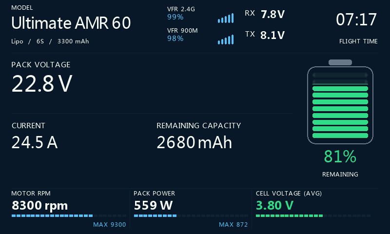

Valg: **Display style = Deck**; **Image source = Hidden**; **Lower deck > Show = RPM + W + cell**; **Meter style = Retro LCD**; **Remaining from = Consumed mAh**; **mAh display = Remaining**; **RPM value = Measured RPM**; **Background = Custom**.

## Manglende data og varsling

Configured source unavailable

Valg: **Display style = Deck**; **Image source = Hidden**; **Lower deck > Show = RPM + W + cell**; **Meter style = Retro LCD**; **Remaining from = Consumed mAh**; **mAh display = Remaining**; **RPM value = Measured RPM**; **Custom = ESC temperature (°C)**; **Custom position = 3**.

Low battery

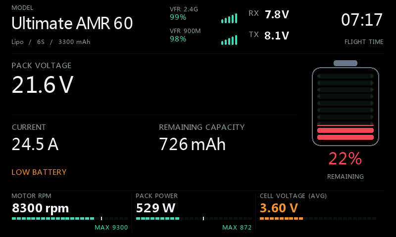

Valg: **Display style = Deck**; **Image source = Hidden**; **Lower deck > Show = RPM + W + cell**; **Meter style = Retro LCD**; **Remaining from = Consumed mAh**; **mAh display = Remaining**; **RPM value = Measured RPM**.

## Øvrige valg og kildeavhengigheter

Dette galleriet dekker de ulike visningsvalgene; det er ikke alle kombinasjoner av egendefinerte farger, sensornavn og tallverdier. **Radio theme / Black / Custom**, egen aksentfarge og valgfri font kan tilpasses uavhengig. La Font file være tom for native ETHOS-fonter. Fullskjerm betyr hele LCD-flaten til radioen, også ved lavere oppløsning.

Batteritypene er **Lipo / LiHV / Li-ion / LiFe**. RPM-skala kan være manuell eller følge motor-KV og batteriet; KV-estimat er merket og er ikke en måling. Egne metergrenser, rød sone, Custom-enhet/desimaler, RF-profiler, alarmer og flylogg er beskrevet i oppsettsguiden.

Grå felt beholder verdiene sine. En kilde kan fortsatt være nødvendig for beregning, alarm eller logg når et instrument er skjult. Manglende måling vises som ukjent, ikke null eller fullt. Behold ekte Synthetic preview-varsel og slå Preview av ved vanlig bruk. Se [oppsettsguiden](Konfigurasjon-norsk.md) for full feltreferanse og [NOTICE](../NOTICE.md) for modellbilder.
